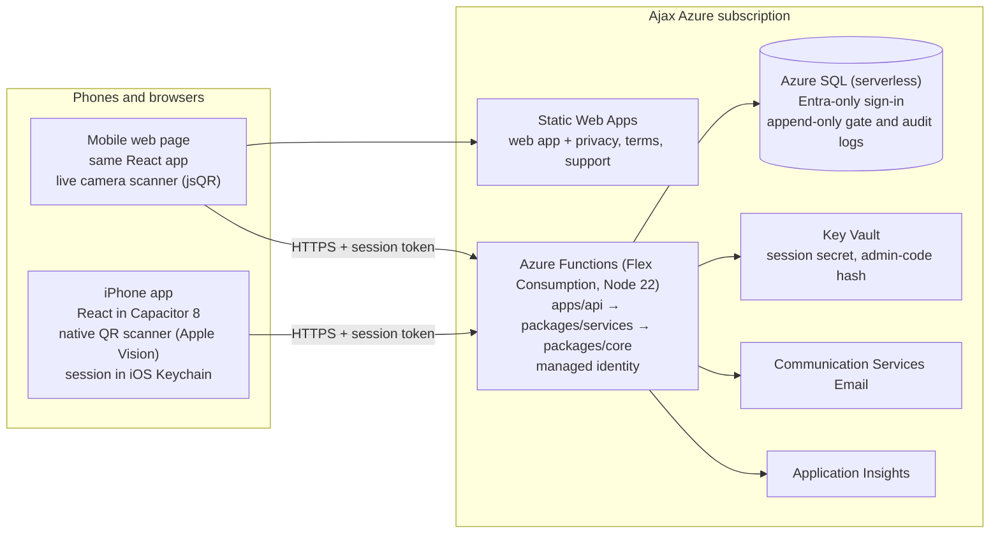

# Architecture

## Layers

| Layer | Folder | Job | Knows about |
|---|---|---|---|
| Rules | `packages/core` | Delivery and gate rules, account and permission rules, QR codes, site time | Nothing else: pure functions |
| Services | `packages/services` | Every use case (sign up, book, approve, scan…) with its permission checks, notifications and audit | Core, plus a `Store` and a `Mailer` interface |
| API | `apps/api` | HTTP routes, sessions, body validation (zod), CORS, the SQL store and the email sender | Services |
| App | `apps/web` | Screens for all three roles | An `Api` interface with two implementations |

The app runs `packages/core` too, so the booking form shows the 12 checks live as the contractor types. The API runs the same file to make the real decision, so the two can't disagree.

The app talks to an `Api` interface:

- `HttpApi` calls the Granted API (production, pilot and local development).
- `DemoApi` runs `packages/services` in the browser on demo data, with no server. The public demo and `npm run demo` use it.

Both go through the same services code, so the demo enforces exactly the same rules and permissions as production.

## Data

Each collection is a table in Azure SQL. The table has an id, the record as JSON, and indexed computed columns for the fields the services look up (`db/migrations/001_schema.sql`). The record shapes are in `packages/services/src/types.ts`:

| Collection | Holds |
|---|---|
| users | Name, email, phone, company, Ajax flag (from the confirmed email), admin-account flag |
| credentials | Password hash, salt, work factor, recent failures, session version, pending email code (hashed) |
| projects | Name, location, code, settings (rules, gate hours, time zone), gates, zones, look-ahead, suspended companies |
| members | Project, user, role, trade, status, how they joined |
| joinreqs, invites | Requests to join, and invites bound to an email |
| requests, passes | Deliveries with the rule decision and reasons; single-use gate passes |
| gatelog | Every admit and turn-away (append-only) |
| mail | Delivery and team emails (the in-app Messages and Activity) |
| audit | Security-relevant actions (append-only) |
| throttle | Rate-limit counters |

**Times.** Stored times are UTC instants. Each project has a time zone, and the rules run on that site's wall clock (`packages/core/src/time.ts`). The API runs with `TZ=UTC`, so daylight-saving changes are handled by the platform's time-zone data. Tests run the same way.

**Concurrency.** Booking, approving and admitting run inside one database transaction that holds an exclusive application lock on the project (`SqlStore.withLock`). The last slot can't be double-booked, and a pass can't be admitted twice.

## Sign-in options

| Mode | How | When |
|---|---|---|
| `AUTH_MODE=local` (built) | Granted's own email and password: PBKDF2-SHA256 hashes, 6-digit email codes, lockout, signed session tokens with a session version | Works now with no extra Microsoft set-up |
| `AUTH_MODE=external` (API built, app screens to connect) | Microsoft Entra External ID holds passwords and email codes. The app uses the Native Authentication SDK (`@azure/msal-browser/custom-auth`) so the screens stay in-app. The API checks External ID tokens (signature, issuer, audience) and links them to a Granted profile (`POST /api/auth/profile`). Ajax staff can be offered "Sign in with Microsoft". | Recommended for production once Ajax IT sets up the External ID tenant |

## API routes

All under `/api`. Everything except `auth/*` and `health` needs a session.

| Route | Does |
|---|---|
| `POST auth/signup`, `auth/verify`, `auth/resend`, `auth/signin`, `auth/forgot`, `auth/reset` | Accounts (local mode) |
| `POST auth/profile` | First sign-in with External ID |
| `GET me`, `PATCH me`, `POST me/password`, `DELETE me` | Home data, profile, password, account deletion |
| `POST projects`, `POST projects/join` | Create a project (Ajax admin accounts), enter a code |
| `GET projects/:id` | The project view for the caller's role |
| `PATCH projects/:id/settings`, `PUT projects/:id/lookahead`, `POST projects/:id/code`, `DELETE projects/:id`, `POST projects/:id/leave`, `POST projects/:id/suspend` | Project admin |
| `POST joinreqs/:id/decision`, `POST projects/:id/invites`, `DELETE invites/:id`, `PATCH members/:id`, `DELETE members/:id` | Team |
| `POST projects/:id/requests`, `DELETE requests/:id`, `POST requests/:id/decision`, `POST projects/:id/emergency`, `POST projects/:id/noshow` | Deliveries |
| `POST projects/:id/gate/check`, `gate/admit`, `gate/turnaway` | Gate |

**Maintenance mode** is the `X-Granted-View-As` header. The API honours it only for an Ajax admin account that is an Admin on that project. It changes the role used for every check, which can only narrow what the admin can do. Actions taken that way are marked `maintenance`.

A timer function runs the no-show check at five past every hour.
